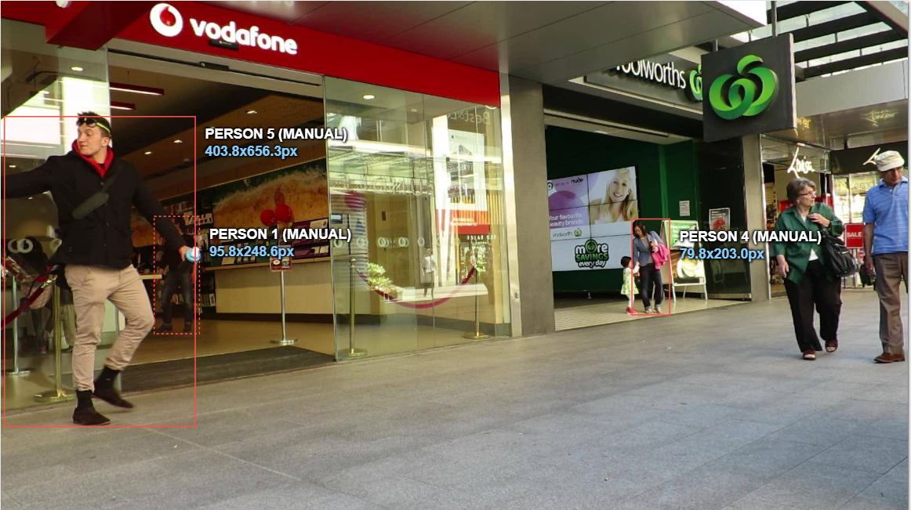
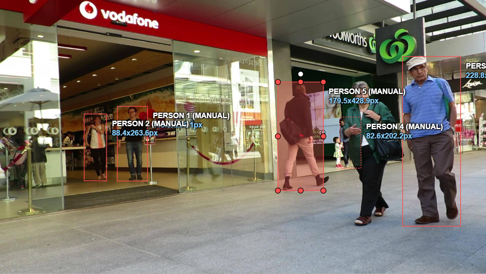
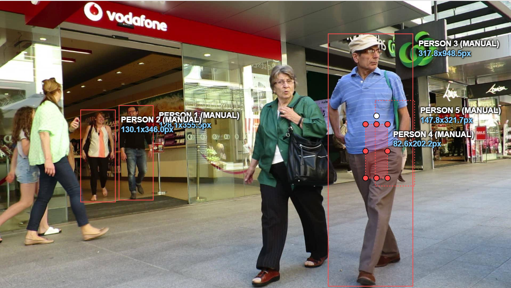

# Báo cáo cá nhân — PhamVoQuangHung-2A202603259

Đổi tên file theo quy tắc `MSSV_HoTen.md`. Ví dụ: `20241234_NguyenVanAn.md`.

Đoạn video: MOT17-09, 150 frame (frame 1–150), nguồn MOTChallenge, giấy phép CC BY-NC-SA 3.0.

## 0. Thông tin học viên

- Họ tên: Phạm Võ Quang Hưng
- MSSV: 2A202603259
- Mã đề (A/B/C): C
- Email: 26ai.hungpvq@vinuni.edu.vn
- Link repository: https://github.com/QuangHung259/K5-L2-DAY05-PhamVoQuangHung-2A202603259-MOTTracking
- Giờ bắt đầu: 17h00
- Giờ kết thúc: 19h30

## 1. Xem trước đoạn video (CP0)

Ghi **trước khi vẽ**, mỗi người một dòng.

| Mã | Frame xuất hiện | Frame cuối thấy được | Rẽ / dừng / đổi tốc độ ở frame | Bị che ở frame | Ghi chú |
|---|---|---|---|---|---|
| P1 | 0 | 149 | Rẽ ở frame 70 xoay lưng và đi nhanh | Bị che ở frame 26 đến frame 54 | Đi bên trong cửa hàng rồi bước ra, bị người đi ngang che khuất |
| P2 | 60 | 149 | Bắt đầu rẽ và đi ở frame 67 | Bị che ở frame 60 đến 79 | Mới xuất hiện bị che một phần ở cửa hàng, sau đó đi thẳng về phía camera |
| P3 | 39 | 149 | Tốc độ đều từ frame 39 đến 149 | Không bị che | Đi từ mép phải sang trái với tốc độ ổn định |
| P4 | 0 | 149 | Dừng lại từ frame 24 | Bị che từ frame 89 đến 149 | Đứng ở phía xa rồi bị dòng người đi trước che khuất liên tục |
| P5 | 27 | 149 | Đổi tốc độ từ frame 42 | Bị che từ frame 117 đến 149 | Đi từ rìa trái vào giữa khung hình, cuối đoạn bị che khuất |

## 2. Keyframe và thời gian (CP1, CP4)

Số keyframe lấy từ kết quả `src/check_submission.py`.

| Mã | Số keyframe | Keyframe ở frame | Số frame có mặt | Keyframe / 100 frame | Thời gian (phút) | Chỗ khó |
|---|---:|---|---:|---:|---:|---|
| P1 | 19 | 0, 10, 20, 26, 30, 40, 50, 54, 55, 60, 70, 80, 90, 100, 110, 120, 130, 140, 149 | 150 | 12.7 | 15 | Bị người đi ngang che khuất từ frame 26–54 và đổi hướng, tăng tốc ở khoảng frame 70 |
| P2 | 10 | 60, 70, 80, 90, 100, 110, 120, 130, 140, 149 | 90 | 11.1 | 10 | Lúc mới xuất hiện ở frame 60–79 bị che một phần, bắt đầu rẽ và tiến lại gần camera làm kích thước box thay đổi |
| P3 | 12 | 39, 49, 59, 69, 79, 89, 99, 109, 119, 129, 139, 149 | 111 | 10.8 | 10 | Xuất hiện từ sát mép phải khung hình (frame 39), cần căn box sát mép khi bước vào |
| P4 | 13 | 0, 10, 20, 40, 50, 60, 70, 80, 89, 99, 109, 129, 139 | 150 | 8.7 | 10 | Kích thước người ở xa nhỏ, dừng lại lâu và bị che khuất nhiều từ frame 89 về cuối |
| P5 | 14 | 27, 30, 37, 47, 57, 67, 77, 87, 97, 107, 117, 127, 137, 149 | 123 | 11.4 | 10 | Bước vào từ rìa trái với kích thước lớn, đổi tốc độ quanh frame 42 và bị che từ frame 117 |
| **Tổng** | **68** | — | **624** | **10.9** | **55** | — |

Keyframe / 100 frame của cả bài = tổng keyframe ÷ tổng số frame có mặt × 100 = 68 ÷ 624 × 100 = **10.9** keyframe / 100 frame.

Bạn đặt keyframe nhiều nhất ở người nào? Vì sao (người đó rẽ, dừng, lại gần camera hay bị che)?

Tôi đặt keyframe nhiều nhất ở **P1** (19 keyframe, mật độ 12.7 keyframe / 100 frame). Lý do là P1 xuất hiện xuyên suốt cả 150 frame (0–149), có đoạn bị người khác đi ngang che khuất dài (từ frame 26 đến frame 54) nên cần đặt thêm các keyframe sát điểm bắt đầu bị che (frame 26) và điểm kết thúc bị che / thấy rõ lại (frame 54, 55) để ước lượng amodal box chính xác. Ngoài ra, từ khoảng frame 70 P1 xoay lưng rẽ hướng và đi nhanh hơn, khiến giả định vận tốc đều của nội suy tuyến tính không còn khớp nên cần thêm keyframe để box bám sát người.

## 3. Đoạn bị che (CP2)

Người bị che: `P1`

| Mốc | Frame |
|---|---:|
| Bắt đầu bị che một phần (bật `occluded`) | 26 |
| Mất hẳn (bật `outside`) | Không mất hẳn (vẫn ước lượng được vị trí amodal box trong đoạn che 26–54) |
| Hiện lại (tắt `outside`) | Không bật `outside` (duy trì track liên tục qua đoạn che) |
| Thấy rõ trở lại (tắt `occluded`) | 55 |

- Thời gian bị che khuất: 29 frame (từ frame 26 đến hết frame 54) = 0.97 giây (ở 30 fps; thời gian khuất hẳn `outside`: 0 frame = 0 giây).
- Quyết định: **Giữ cùng ID** (Track 0 / ID 1).
- Lý do (trả lời 3 câu: khuất bao lâu so với 60 frame, ngoại hình có khớp, chỗ hiện lại có đúng hướng và tốc độ):
  1. **Thời gian khuất so với ngưỡng 60 frame:** Tổng thời gian P1 bị người đi ngang che khuất chỉ kéo dài 29 frame (~0.97 giây), nhỏ hơn nhiều so với ngưỡng 60 frame (2 giây) của lớp.
  2. **Ngoại hình:** Trước và sau khi bị che, đối tượng giữ nguyên ngoại hình (trang phục tối màu, dáng người và kích thước bounding box đồng nhất).
  3. **Hướng đi và tốc độ:** Vị trí P1 lộ diện rõ trở lại ở frame 55 hoàn toàn khớp với quỹ đạo di chuyển, hướng bước đi và vận tốc trước khi bị che ở frame 26. Do đó quyết định giữ nguyên cùng một Track ID.

Ảnh chụp màn hình:





*(Nguồn ảnh: MOT17, MOTChallenge — Milan et al., 2016)*

## 4. Tự review ID (CP3)

Lượt 1 theo người (đi ngược từ frame 149 về 0 trên CVAT), lượt 2 theo cảnh (nhảy 10 frame). Ít nhất 3 dòng; không có lỗi thì ghi một dòng "đã kiểm hai lượt, không lỗi".

Loại lỗi dùng đúng một trong 7 mã: `id_switch`, `fragmentation`, `lost`, `merge`, `false_track`, `drift`, `flag`.

| Frame | Mã người | Loại lỗi | Mô tả một câu | Phát hiện ở lượt | Đã sửa? |
|---:|---|---|---|---|---|
| 26–54 | P1 | `flag` | Quên bật cờ `occluded` ở một số frame khi P1 bị người đi ngang che khuất một phần. | Lượt 1 (theo người) | Đã sửa (bật `occluded` từ frame 26 đến 54, tắt ở frame 55) |
| 30 | P5 | `drift` | Box nội suy giữa frame 27 và 37 bị trôi nhẹ so với thân người khi P5 bước nhanh từ rìa trái vào khung. | Lượt 1 (theo người) | Đã sửa (thêm keyframe tại frame 30) |
| 89–149 | P4 | `flag` | Chưa bật đủ cờ `occluded` ở đoạn cuối khi P4 đứng phía xa và bị người đi qua che khuất. | Lượt 2 (theo cảnh) | Đã sửa (bật `occluded` từ frame 89 đến 149) |

Tổng hợp số lỗi theo loại:

| `id_switch` | `fragmentation` | `lost` | `merge` | `false_track` | `drift` | `flag` |
|---:|---:|---:|---:|---:|---:|---:|
| 0 | 0 | 0 | 0 | 0 | 1 | 2 |

Lỗi nào chỉ lượt 2 (theo cảnh) mới thấy, lượt 1 (theo người) không thấy? Vì sao?

Ở **lượt 2 (duyệt theo cảnh, nhìn tổng thể cả 5 box cùng lúc)** dễ phát hiện các lỗi tương tác giữa nhiều người như `flag` (quên bật `occluded` khi hai người giao cắt/che nhau như P4 bị dòng người phía trước che từ frame 89), `merge` (một box bao trùm hai người đi sát nhau) hoặc `id_switch` / trùng track giữa hai đối tượng. Khi duyệt **lượt 1 (theo từng người)**, mắt chỉ tập trung bám theo một box duy nhất đi ngược thời gian nên rất nhạy với lỗi `drift` (hộp trôi khỏi cơ thể người đó), nhưng dễ bỏ qua tương quan vị trí với các box của người khác xung quanh.

## 5. File xuất và kết quả tự kiểm (CP4)

| Kiểm tra | Kết quả |
|---|---|
| Tên file MOT 1.1 | `src/exports/PhamVoQuangHung_mot.zip` |
| Tên file CVAT for video 1.1 | `src/exports/PhamVoQuangHung_cvat_video.zip` |
| Số track ID khác nhau trong `gt/gt.txt` (phải là 5) | 5 |
| Frame `outside` không có dòng trong `gt.txt` (đúng / sai) | Đúng (các frame người chưa xuất hiện / `outside` như P2 trước frame 60, P3 trước frame 39, P5 trước frame 27 đều không có dòng trong `gt.txt`) |
| Job đã completed trên CVAT máy cá nhân | Đã completed |

Dán phần tóm tắt in ra từ `src/check_submission.py`:

```text
Số frame in theo CVAT (bắt đầu từ 0). Trong gt.txt, frame_id = frame CVAT + 1.

=== File MOT 1.1: PhamVoQuangHung_mot.zip ===
  Số track ID: 5   |   Tổng số box: 624
  [OK]        Đúng 5 track ID.

  Track | Frame có mặt | Số frame | Đoạn vắng (outside)
      1 |   0–149      |      150 | -
      2 |   0–149      |      150 | -
      3 |  27–149      |      123 | -
      4 |  39–149      |      111 | -
      5 |  60–149      |       90 | -


=== File CVAT for video 1.1: PhamVoQuangHung_cvat_video.zip ===

  Track | Nhãn   | Frame thấy | Keyframe | KF/100 frame | Frame occluded | Lần bật outside
      0 | person |        150 |       19 |         12.7 |             29 |               0
              Track 0: keyframe ở frame [0, 10, 20, 26, 30, 40, 50, 54, 55, 60, 70, 80, 90, 100, 110, 120, 130, 140, 149]
      1 | person |         90 |       10 |         11.1 |             20 |               0
              Track 1: keyframe ở frame [60, 70, 80, 90, 100, 110, 120, 130, 140, 149]
      2 | person |        111 |       12 |         10.8 |              0 |               0
              Track 2: keyframe ở frame [39, 49, 59, 69, 79, 89, 99, 109, 119, 129, 139, 149]
      3 | person |        150 |       13 |          8.7 |             61 |               0
              Track 3: keyframe ở frame [0, 10, 20, 40, 50, 60, 70, 80, 89, 99, 109, 129, 139]
      4 | person |        123 |       14 |         11.4 |             33 |               0
              Track 4: keyframe ở frame [27, 30, 37, 47, 57, 67, 77, 87, 97, 107, 117, 127, 137, 149]

  Tổng: 68 keyframe / 624 frame có mặt = 10.9 keyframe / 100 frame
  [OK]        Đọc được 5 track từ annotations.xml.

=== Tóm tắt ===
  Lỗi: 0   |   Cảnh báo: 0
  Đạt. Dán phần tóm tắt này vào báo cáo mục 5.
```

## 6. Ba câu kết

1. Nếu được gán lại, bạn sẽ đặt keyframe khác ở đâu? Vì sao?

   Nếu được gán lại, ở những đoạn người đi bộ di chuyển thẳng đều hoặc đứng yên (như P3 đi đều từ phải sang trái hoặc P4 khi đứng yên từ frame 20–40), tôi sẽ giãn khoảng cách giữa các keyframe ra (mỗi 15–20 frame thay vì nhảy đều mỗi 10 frame) và dồn thêm keyframe vào đúng các điểm uốn chuyển động (ngay lúc P1 bắt đầu xoay người rẽ ở khoảng frame 68–75, hoặc lúc P2 bắt đầu rẽ ở frame 67). Vì nội suy tuyến tính của CVAT đã mô hình hóa tốt các đoạn vận tốc không đổi, việc giảm keyframe thừa ở đoạn thẳng đều và tập trung vào khúc ngoặt giúp giảm thời gian gán nhãn mà box vẫn bám sát đối tượng hơn.

2. Có chỗ nào bạn không chắc "cùng ID hay ID mới"? Bạn đã quyết định và ghi chú thế nào?

   Chỗ phân vân nhất là ở **P1** trong khoảng frame 26–54 (khi bị người đi ngang che khuất) và **P4** từ frame 89–149 (khi đứng ở xa và bị nhiều người đi qua che khuất liên tục). Với P1, có những frame bị che gần hết thân người, khiến tôi cân nhắc giữa việc bật `outside` hay giữ `occluded` và liệu khi lộ rõ lại ở frame 55 có chắc chắn cùng một người hay không. Áp dụng quy tắc 3 câu hỏi của lớp: thời gian bị che chỉ 29 frame (< 60 frame), trang phục và dáng người khớp hoàn toàn, vị trí xuất hiện lại ở frame 55 đúng với hướng đi và tốc độ cũ, nên tôi quyết định **giữ cùng ID** và dùng amodal box kèm cờ `occluded`.

3. Một lỗi ID trong job của bạn (nếu không còn sót, chọn lỗi đã sửa) có thể làm xe tự lái dự đoán sai chuyển động của người đó như thế nào? Lỗi đó ảnh hưởng MOTA hay IDF1 nhiều hơn?

   Nếu xảy ra lỗi `id_switch` (ví dụ tại đoạn giao cắt frame 26–54 của P1 với người đi ngang qua) hoặc lỗi `drift` (như tại frame 30 của P5 khi box bị trôi lệch so với vị trí thực), hệ thống dự đoán quỹ đạo (trajectory prediction / Kalman Filter) của xe tự lái sẽ tính toán sai vận tốc và hướng di chuyển tức thời của người đi bộ. Cụ thể, nếu `id_switch` giữa hai người cách nhau 1.5 m trong 1 frame (1/30 giây), vận tốc ước lượng sẽ nhảy vọt ảo lên tới ~45 m/s (~162 km/h) hoặc đảo ngược vector vận tốc, khiến xe tự lái phanh gấp không cần thiết hoặc dự đoán sai điểm cắt mặt gây nguy hiểm.
   Về độ đo đánh giá, lỗi `id_switch` (hoặc `fragmentation`) ảnh hưởng tới **IDF1 nhiều hơn MOTA**: trong công thức MOTA, một lần đổi ID chỉ bị phạt 1 lỗi `IDSW` tại đúng frame chuyển đổi trên tổng số hàng trăm box (làm MOTA giảm rất ít, dưới 0.2%), trong khi **IDF1** đánh giá tính nhất quán định danh xuyên suốt toàn bộ thời gian sống của quỹ đạo — nếu đổi ID ở giữa đoạn, toàn bộ nửa sau của track bị tính là sai định danh (IDFP / IDFN), kéo điểm IDF1 giảm mạnh.

## Bonus (nếu làm)

### B1 — Hai người đi sát

Không thực hiện.

### B2 — So cách đặt keyframe

| Cách đặt | Số keyframe | Frame trôi nhất | Ghi chú |
|---|---:|---:|---|
| Đều mỗi 30 frame | — | — | Không thực hiện |
| Theo chỗ đổi hướng | — | — | Không thực hiện |

### B3 — So với tracker có sẵn

| Frame | Mã người | Tracker làm gì | Nhãn của bạn | Giải thích (đoán rồi sửa / ghép IoU / box score thấp / ngoại hình) |
|---:|---|---|---|---|
| — | — | — | — | — |

## 7. Tài liệu tham khảo và công cụ AI đã dùng

- **Bộ dữ liệu:** MOT17-09, MOTChallenge (Milan et al., 2016), giấy phép CC BY-NC-SA 3.0.
- **Tài liệu hướng dẫn bài Lab:** `README.md`, `CHECKPOINTS.md`, `docs/GUIDELINE.md`, `docs/MOT_FORMAT.md`, `lab_day05_walkthrough.md`.
- **Công cụ sử dụng:**
  - CVAT Community (chạy local qua Docker) để gán nhãn Track mode và xuất định dạng `MOT 1.1` & `CVAT for video 1.1`.
  - Script `src/setup_local_lab.py` và `src/check_submission.py` để khởi tạo task và kiểm tra định dạng, thống kê số lượng keyframe.
 
